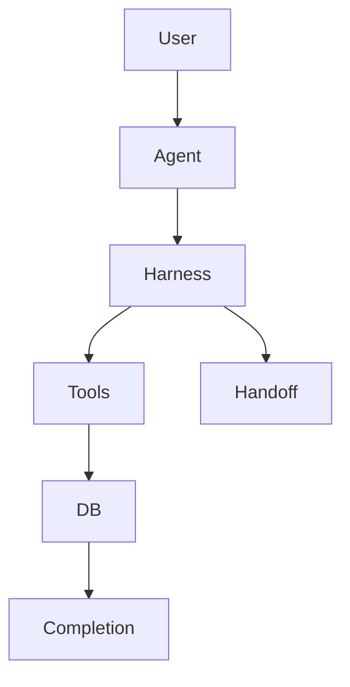
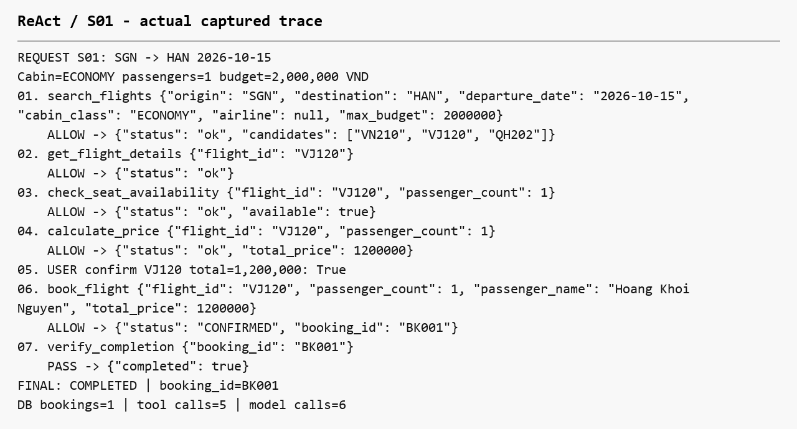
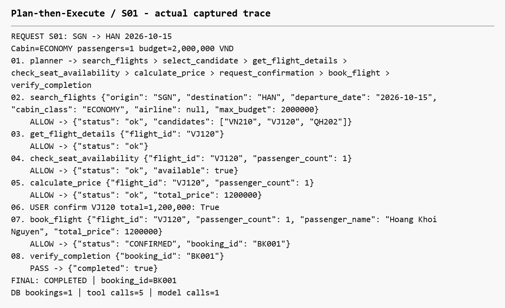
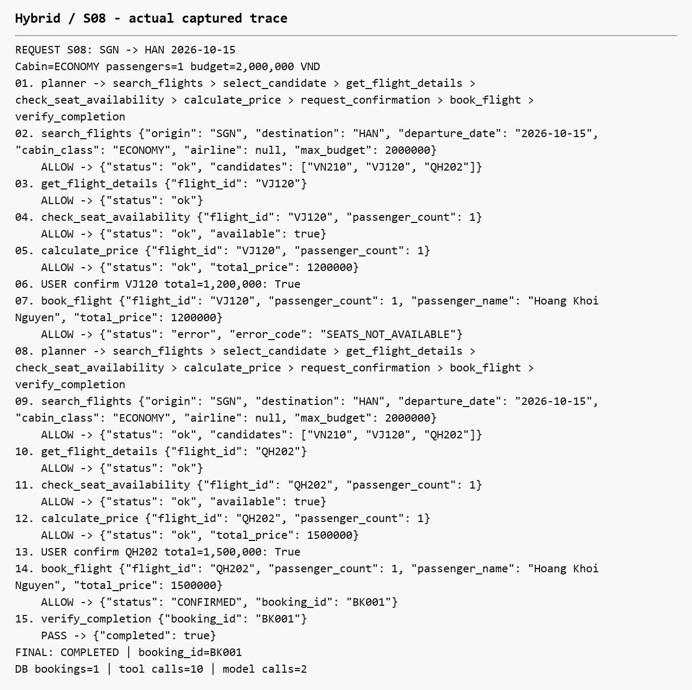
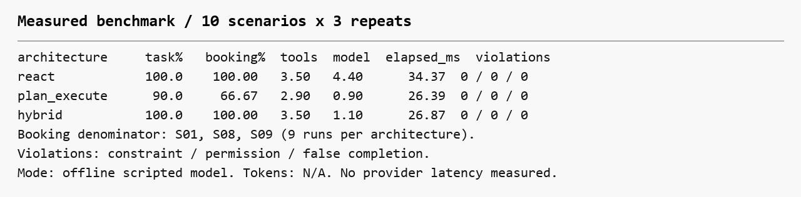
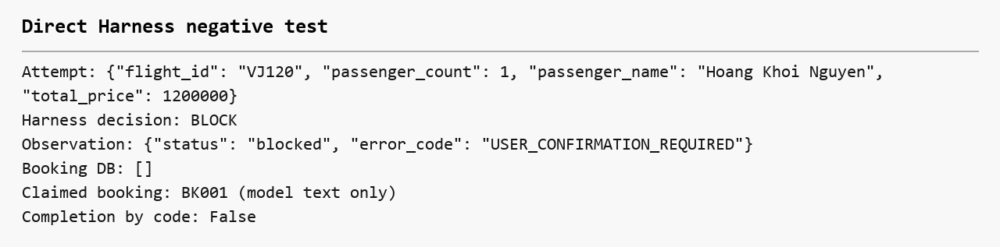

# BTVN 3 — Xây dựng Agent đặt vé máy bay bằng LangChain và LangGraph

Hoàng Khôi Nguyên · 24521176 · SE373.R11. Ngày nộp chưa xác định trong đề bài.

## 1. Giới thiệu bài toán

Đặt vé nội địa một chiều trong môi trường mock SGN/HAN/DAD.

## 2. Mục tiêu

Harness kiểm ràng buộc, permission, completion và handoff; so sánh ReAct/PTE/Hybrid.

## 3. Công nghệ

Python 3.12; LangChain 1.4.3; LangGraph 1.2.13; Pydantic 2.13.5; pytest 9.1.1; python-dotenv; langchain-openai tùy chọn.

## 4. Mock flight environment

10 chuyến, 15–16/10/2026; DB in-memory reset từng lượt; tiền VND nguyên, budget tổng booking.

Tools: search_flights, get_flight_details, check_seat_availability, calculate_price, book_flight.

## 5. Harness

BookingRequest frozen. Gate kiểm schema và constraint. Approval gắn fingerprint request, chuyến, số khách, tổng tiền. Completion đọc booking/audit; kiểm request, route/ngày/cabin/hãng/tên/giá/ngân sách/status. Handoff gồm stop_reason/da_thu/trang_thai/cau_hoi_cho_nguoi.



## 6. ReAct

create_agent + BaseChatModel scripted + wrap_tool_call gate. Observation quyết định tool kế tiếp, adaptive retry khi hết ghế.



## 7. Plan-then-Execute

Structured plan tám bước; StateGraph thực thi tuần tự, không re-plan baseline. S08 dừng PLAN_INVALIDATED.



## 8. Hybrid

Plan + kiểm observation từng bước + tối đa 2 replans. Hủy approval cũ và xin confirm chuyến thay thế.



## 9. Thiết kế thực nghiệm

S01–S10 × 3 architecture × 3 lần = 90 lượt offline; reset DB độc lập. 82 tests passed.

S01 success; S02 thiếu policy; S03 thiếu input; S04 no flight; S05 pending; S06 decline; S07 sold out; S08 mất ghế trước booking; S09/S10 budget hai khách.

## 10. Kết quả thực tế

| Metric | ReAct | PTE | Hybrid |

|---|---:|---:|---:|

| Task Success Rate | 100.00% | 90.00% | 100.00% |

| Booking Success Rate | 100.00% | 66.67% | 100.00% |

| Constraint Violation Rate | 0.00% | 0.00% | 0.00% |

| Permission Violation Rate | 0.00% | 0.00% | 0.00% |

| False Completion Rate | 0.00% | 0.00% | 0.00% |

| Tool calls trung bình | 3.50 | 2.90 | 3.50 |

| Model calls trung bình | 4.40 | 0.90 | 1.10 |

| Execution time TB (ms) | 34.37 | 26.39 | 26.87 |

| Handoff đúng / tổng | 21/21 | 24/24 | 21/21 |

| Token usage | N/A | N/A | N/A |

Task denominator 30/architecture; booking denominator 9/architecture (S01/S08/S09). PTE S08 là safe handoff đúng nhưng không hoàn thành mục tiêu booking. Tool count gồm proposal bị chặn; model count là scripted/planner calls. Timing gồm dựng graph, không gồm user input hoặc export.



## 11. So sánh ba architecture

S08: ReAct retry; PTE invalidated; Hybrid re-plan. Số calls của PTE thấp hơn một phần vì dừng sớm.

## 12. Nhận xét

Không có constraint/permission violation hoặc false completion trong benchmark. Chênh lệch phản ánh policy/orchestration được lập trình, chưa phản ánh reasoning của LLM thật.



## 13. Hạn chế

Mock DB/flight, không payment/API thật, benchmark nhỏ deterministic. Chưa chạy provider; token N/A. Không durable resume; idempotency trong session. Ngày tham chiếu 06/10/2026 cố định cho fixture. Constraint update cần session mới.

## 14. Kết luận

Đã xây đủ ba architecture và Harness, kiểm bằng 82 tests cùng 90 lượt benchmark. Không kết luận architecture tốt nhất cho hệ thống thật.

## 15. Hướng dẫn chạy

Xem README.md để setup. Trong folder project:

```powershell
.\.venv\Scripts\python.exe main.py --agent react
.\.venv\Scripts\python.exe main.py --agent plan_execute
.\.venv\Scripts\python.exe main.py --agent hybrid --scenario S08
.\.venv\Scripts\python.exe -m pytest tests -q
.\.venv\Scripts\python.exe evaluate.py --repeats 3
```

Nguồn: Buoi3.pdf; báo cáo BTVN 02 để tham khảo phong cách/logo; [LangChain middleware](https://reference.langchain.com/python/langchain/agents/middleware/types/wrap_tool_call); [LangGraph routing](https://reference.langchain.com/python/langgraph/graph/state/StateGraph/add_conditional_edges).